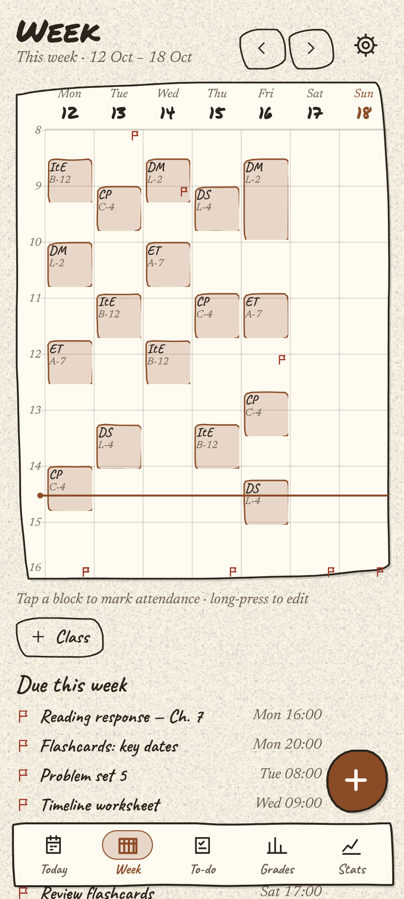
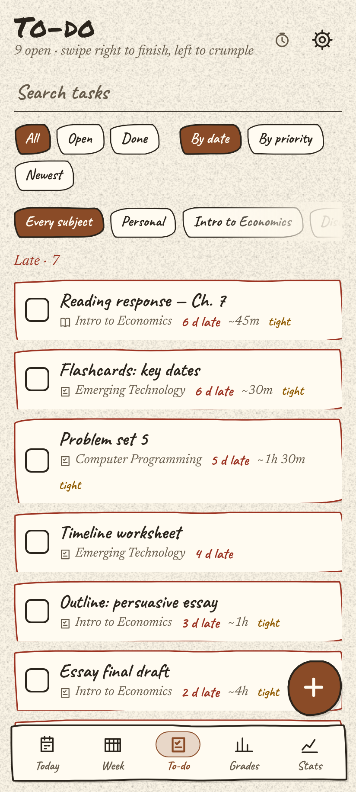
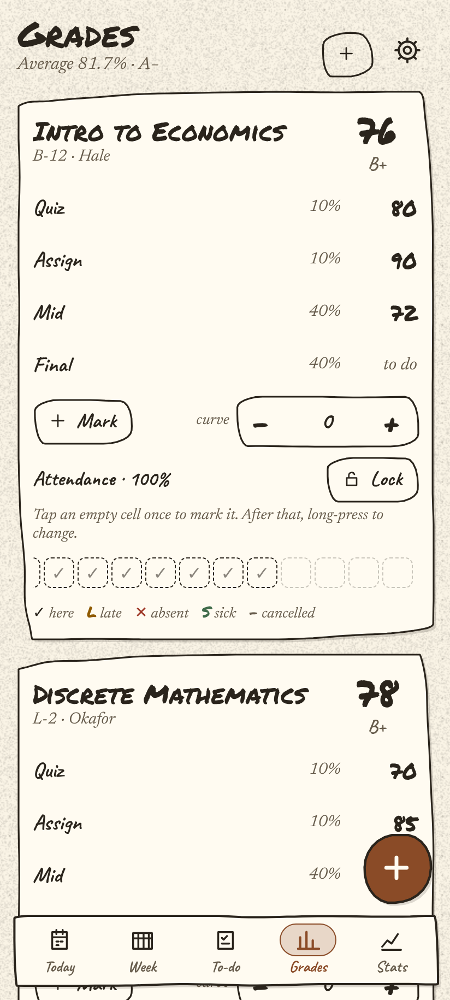
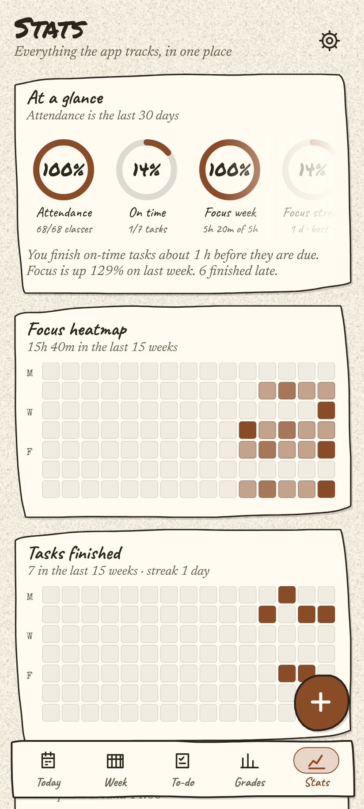

# Margin

**A local-first school planner that keeps the timetable, attendance, assignments, grades and focus time in one SQLite file on your phone — and makes the day legible at a glance.**


[](https://github.com/jossy-dude/margin/actions/workflows/ci.yml)


---

## Features

- **Paper planner, not a dashboard.** Hand-cut cards, taped notes, ruled paper (dots / grid / ruled / plain), grain or photographic texture, light and dark, and four typefaces — Caveat and Permanent Marker for handwriting and headings, Newsreader italic for prose, Special Elite for typewriter numerals.
- **Five live analog clock faces** — each different at a glance, all drawn from the real clock, all readable on cream and dark. Pick one in Settings → Clock face.
- **Today command deck.** One inverted card that answers "what class, where, how long is left, what's next" — with a live countdown and a progress instrument. Sixteen subject-flavoured **instrument bars** (a sight glass, a gauge, a spectrum analyser, a B-tree cursor…) count the current period from the real clock; the day-wide sight glass reads the whole day.
- **Week timetable.** Seven columns on a time grid with a live now-line, week paging, tap a block to mark attendance, long-press to edit, plus everything due that week.
- **Assignments with reminders.** Subtasks, estimates, priorities, start-by nudges and per-task reminder times. Swipe right to finish, left to crumple — the paper balls up and drops off the table, and Undo brings it back.
- **Attendance.** Per class and per whole day: here / late / absent / sick / cancelled. Tap once to mark, hold to change, a lock so nothing moves by accident. A class that has ended is inferred as "here" so an unmarked day is visible, not silent.
- **Grades that do the maths.** Weighted marks with an on/off flag per mark, a curve per subject, an optional goal percentage, and the sentence that matters — *for your goal percentage, the average you need on the remaining weight*, or an honest *"goal is out of reach"*. Letter grades included.
- **Focus timer with a real dial.** Drag the ring to set 25 / 45 / 50 / 90 minutes, flow mode that lets a round overrun, breaks that unlock after five minutes of work, and the screen stays awake while it runs.
- **Statistics.** Attendance, on-time and focus rings; 15-week focus and task heatmaps; when you work best; focus by subject; attendance by subject and a four-week attendance heatmap; totals against goals; mark history.
- **Onboarding tour.** Five screens that teach the five things a first-time user cannot guess — replayable from Settings.
- **Export as an escape hatch.** The whole dataset to **xlsx** (one sheet per table), **csv** (one file per table, zipped) or **json**, saved to a folder or shared out.
- **Diagnostics page.** The app's own crash log, readable and copyable in plain text, with a test-crash button.
- **Android reminders that report back.** Class lead times, task and exam reminders, start-by nudges, active hours, quiet hours, weekend modes, "hold it until class ends", per-subject lead times, and a lock-screen text toggle. A **Delivery status** page counts what is actually queued on the phone, when the next one fires, and what the phone refused. `SCHEDULE_EXACT_ALARM` is declared, and the app quotes an honest window rather than pretending to a promise it cannot read.
- **Local-first, by design.** One SQLite file (`marginalia.db`) on the device. No account, no sign-in, no server, no telemetry. Nothing in `src/` opens a network connection.

## Screenshots

| Week | To-do | Grades | Stats |
| --- | --- | --- | --- |
|  |  |  |  |

Captured from the running web build at 412 × 915.

## Get the APK

Download the latest build from **[GitHub Releases →](https://github.com/jossy-dude/margin/releases/latest)**

The APK is built automatically by the **Release APK** workflow (`.github/workflows/release-apk.yml`). It runs when a `v*` tag is pushed, or by hand from the **Actions** tab via *Run workflow*. Either way the built APK is attached to the release (tag runs) or kept as a downloadable workflow artifact (manual runs).

> It is an `assembleDebug` build signed with the debug keystore that is committed in `android/app/debug.keystore` — installable, but not a Play-store release build.

## Run it yourself

```bash
git clone https://github.com/jossy-dude/margin.git
cd margin
npm install
npm run start:lan
```

Scan the QR with **Expo Go** on your phone (same WiFi). `npm run tunnel` works if the network will not cooperate.

To run the whole quality gate — typecheck, lint, jest and dependency-cruiser — with no device needed:

```bash
npm run check
```

## Build an Android APK yourself

The committed `android/` folder is a plain Gradle project — no `expo prebuild` step, no cloud build:

```bash
npm install
cd android
./gradlew assembleDebug
```

The APK lands at `android/app/build/outputs/apk/debug/app-debug.apk` — built for `arm64-v8a` (`reactNativeArchitectures` in `android/gradle.properties`). The manifest already declares `POST_NOTIFICATIONS`, `SCHEDULE_EXACT_ALARM` and `USE_FULL_SCREEN_INTENT`, so nothing has to be re-declared to grant them later.

## Project layout

| Path | What lives there |
| --- | --- |
| `src/screens/` | The six screens: Today, Week, To-do, Grades, Stats, Focus — plus the onboarding tour and shared card pieces |
| `src/sheets/` | Bottom sheets: the Settings page stack, the add/edit forms, the when-picker, Diagnostics |
| `src/domain/` | Pure logic, no React: time, attendance rules, grade maths, analytics, the timer, the reminder planner |
| `src/data/` | SQLite adapter (`expo-sqlite`), the repository, the seeded demo dataset |
| `src/store/` | One store: state, actions, persistence, hydration |
| `src/services/` | Notifications, audio, haptics, micro-sound effects, xlsx/csv/json export |
| `src/ui/` | The component language: `HandBox` cards, charts, clock faces, instrument bars, paper background, sheets, the onboarding artwork |
| `src/navigation/` | The custom tab navigator ("Book"), window motion, navigator↔store sync |
| `src/tokens/` | Colour, paper and ink tokens; measured contrast ratios |
| `src/test/` | 52 jest suites — behaviour, motion timings, a11y roles, contrast, suppression budgets |
| `android/` | The committed Gradle project, manifest and debug keystore |

## Tech stack

- **Expo SDK 57** / **React Native 0.86** / **React 19** (New Architecture on)
- **React Native Reanimated 4** + worklets for the animation layer
- **expo-sqlite** for storage, **expo-notifications** for reminders, **expo-audio** / **expo-haptics** for feedback
- **TypeScript, strict**
- **jest** (52 suites, 854 tests) + **dependency-cruiser** for module boundaries, **ESLint** with `--max-warnings=0`
- **React Native Web** — the same app runs in a browser for development and screenshots

## Data & privacy

Margin is local-first. Everything — timetable, attendance, marks, tasks, notes, focus sessions, settings — lives in one SQLite file on your phone. There is no account, no sign-in, no server and no analytics. Nothing in the app source opens a network connection; the only network use in this repository is development tooling (the Metro dev server, npm). Reminders are scheduled on the device and need no internet. Export exists so your data is never held hostage, not as a sync service.

## Status / known gaps

**Verified today:** the full `npm run check` gate passes — typecheck, lint, 52 jest suites / 854 tests, and a clean dependency-cruiser run — and the Android JS bundle exports cleanly (`npm run bundle`). The screenshots above are captures of that same build running in a browser.

**Not yet verified on a device:** the native-only surfaces. Notifications and exact alarms, the paper grain and photographic textures, the synthesized paper/stamp/dial sounds, haptics and keep-awake during focus are all implemented but have not had a device pass on this build. `USE_FULL_SCREEN_INTENT` is declared in the manifest but nothing uses it yet — full-screen ringing is not a feature of this build. Reminder delivery on Android also depends on the phone's battery saver and permission state — which is exactly what the in-app **Delivery status** page is for.

**Other honest gaps:** the release APK is a debug-signed build; there is no release signing config yet; and the desktop/laptop surface described in `PRODUCT.md` is a design, not a shipped feature — the phone is the product.

---

MIT © Jossy_dude
